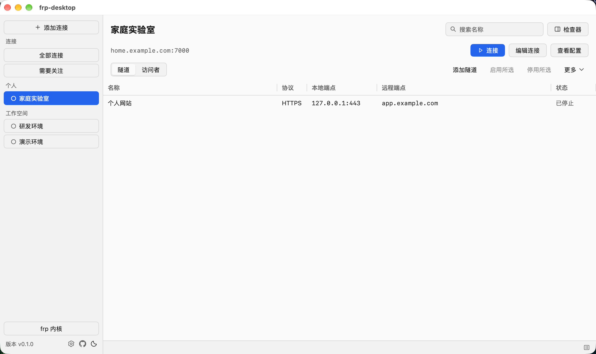

# frp-desktop

[](https://github.com/wan-kong/frpc/releases/latest)
[](https://github.com/wan-kong/frpc/releases/latest)
[](https://github.com/wan-kong/frpc/releases/latest)
[](go.mod)

采用 MyGo 开发的 [frp](https://github.com/fatedier/frp) 客户端管理工具。

## 界面预览



## 下载

各平台安装包见 [GitHub Releases](https://github.com/wan-kong/frpc/releases/latest)。

macOS 应用为 ad-hoc 签名，首次打开需在 Finder 中右键选择“打开”；Windows 安装包未签名，首次运行可能触发 SmartScreen 提示。

## 功能

- 管理多个 frps 连接，每个连接对应独立的 frpc 进程，可同时运行。
- 提供 TCP、UDP、HTTP、HTTPS、STCP、SUDP、XTCP 隧道以及访问者表单。
- 支持导入 `frpc.toml`：可视化编辑器覆盖的字段结构化保存，未覆盖字段保留为加密原文运行。
- 隧道可单独启停；保存只更新配置意图，“应用更改”才会更新运行实例。
- 组合等级、文本、本地时间范围和隧道/访问者标签筛选日志，复制与导出使用同一份筛选结果。
- 关闭主窗口后连接继续在后台运行，可通过 Dock、任务栏或托盘图标重新打开。

## 开发

需要 macOS 13+ 或 Windows 10/11、Go 1.27.3，以及已有的 frps 地址和凭证。

```sh
make dev      # 等价于 go tool mygo dev
make build    # 构建 darwin/arm64、darwin/amd64 与 windows/amd64 到 build/
```

新建连接时选择保底内核，填写 frps 地址、端口和 token，再添加隧道。新连接默认关闭 TLS 和服务器证书校验，可在高级连接设置中启用；自签名环境可以导入 PEM CA。已有 frps 的配置需与客户端设置匹配。

## CLI 检查

```sh
make check    # gofmt、go vet、mygo vet、测试与 race
```

包含单元与 Native UI Tester 检查、Go 检查及 race。

自带当前最新版本的frp内核：`resources/darwin-arm64`、`resources/darwin-amd64` 与 `resources/windows-amd64`。

## 配置与数据

配置与凭证保存在用户目录的 `~/.frpc/config.json`（Windows 为 `%APPDATA%\frpc\config.json`）
